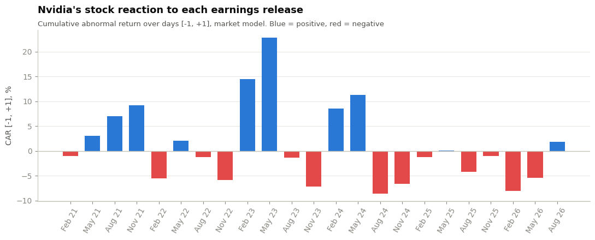
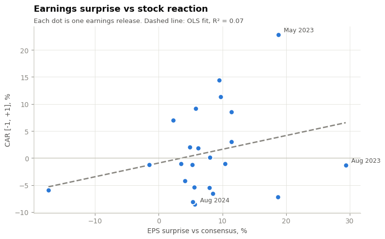
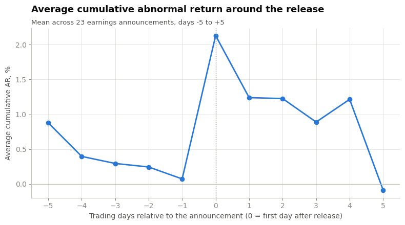
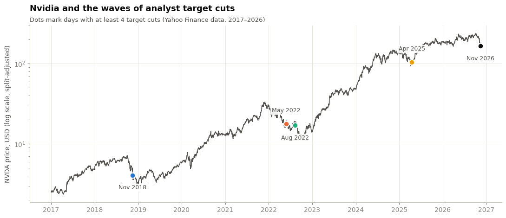
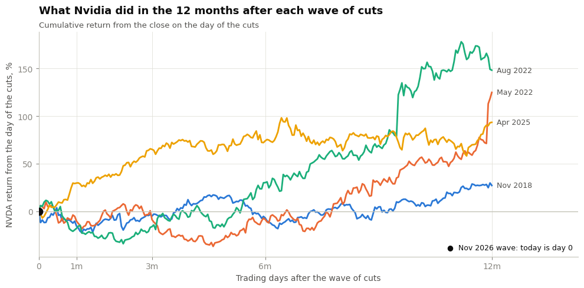
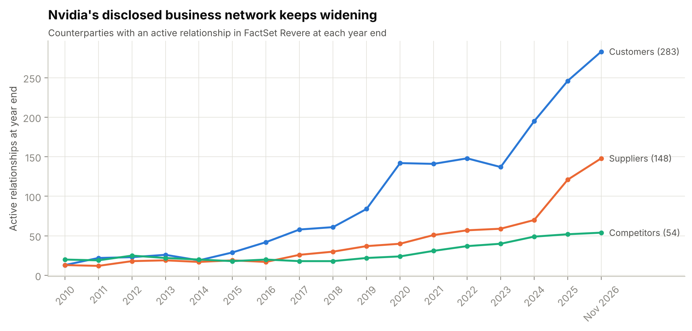
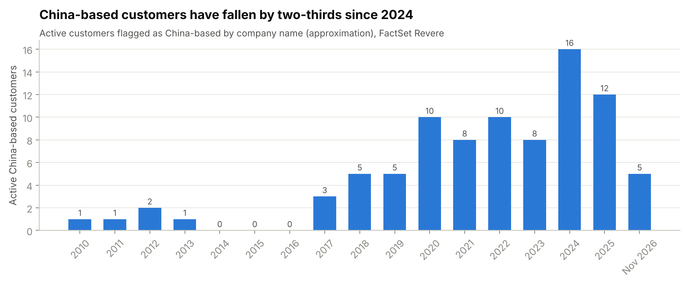

# Nvidia: Narrative vs Fundamentals

**What moves Nvidia's stock price around its earnings announcements: the reported numbers, or something else?**

An event study of 23 quarterly earnings announcements (February 2021 – August 2026) testing whether Nvidia's price reaction is explained by the EPS surprise.

---

## Key results

| | |
|---|---|
| Earnings announcements studied | 23 |
| Quarters with an EPS beat vs consensus | 21 of 23 |
| Announcements with a **negative** abnormal return | 13 of 23 |
| Mean / median CAR [-1, +1] | +0.99% / −1.04% |
| Mean **absolute** CAR [-1, +1] | 6.0% |
| Individually significant announcements (5%) | 7 of 23 |
| R² of CAR on EPS surprise | 0.07 |

- **No systematic direction.** The average reaction is not different from zero (t-test p = 0.56, Wilcoxon p = 0.87). Without the May 2023 announcement, the mean CAR is exactly 0.00%.
- **Large moves, unpredictable direction.** Earnings releases move the stock by 6% on average in absolute terms, and 7 of 23 releases are significant on their own.
- **The EPS beat explains little.** The surprise explains about 7% of the variation in reactions, and its coefficient is not significant (p = 0.22). The largest beat in the sample (Aug 2023, +29%) was followed by a negative reaction; a smaller one (May 2023, +19%) produced the largest jump (+22.8%), driven by revenue guidance.

The evidence is consistent with prices reacting to guidance, AI-demand commentary and expectations above the published consensus, rather than to the reported EPS itself.







---

## Method

1. **Data.** Daily adjusted prices for NVDA and the S&P 500 (^GSPC) from Yahoo Finance, January 2020 to November 2026. Adjusted prices neutralise the June 2024 10-for-1 split.
2. **Event dates.** Quarterly earnings dates with consensus and reported EPS. Nvidia reports after the US market close, so **day 0 is the first trading day after the release**.
3. **Market model.** For each announcement, α and β are estimated by OLS over trading days [−250, −30] relative to day 0. The gap keeps pre-announcement drift out of the estimate. Re-estimating per event matters: Nvidia's beta ranged from 1.3 to 2.9 over the period.
4. **Abnormal returns.** AR = R<sub>NVDA</sub> − (α + β·R<sub>M</sub>); CAR is the sum over [−1, +1]; SCAR = CAR / (σ·√L) gives each event's own t-statistic.
5. **Tests.** Cross-sectional t-test and Wilcoxon signed-rank test (residuals have fat tails, kurtosis ≈ 11); robustness without the largest event.
6. **Narrative vs fundamentals.** Cross-sectional OLS of CAR on the EPS surprise with heteroskedasticity-robust standard errors, and a split around May 2023.

## Limitations

- Small sample: 23 events, so single quarters weigh heavily.
- Consensus EPS from Yahoo Finance rather than I/B/E/S.
- August 2022 results were pre-announced on 8 August 2022, so the official release carried little new information.
- Joint-hypothesis problem: abnormal returns depend on the market model being correct.

## Next steps

- Decompose each reaction into the change in **forward EPS** (fundamentals) and the change in **forward P/E** (narrative) using I/B/E/S data from WRDS.
- Add revenue and guidance surprises as explanatory variables.
- Extend to peers: AMD, Broadcom, TSMC.

## How to run

Open `nvidia_event_study.ipynb` in Google Colab and select **Runtime → Run all**. All data is downloaded from Yahoo Finance, and the end date is fixed so results are reproducible. To run locally:

```bash
pip install -r requirements.txt
jupyter notebook nvidia_event_study.ipynb
```

Study parameters (tickers, dates, estimation and event windows) are set in the first code cell.

## Repository structure

```
├── nvidia_event_study.ipynb   # Part 1: earnings event study
├── nvidia_analyst_cuts.ipynb  # Part 2: analyst cut waves
├── figures/                   # charts used in this README
├── requirements.txt
└── README.md
```

---

# Part 2: When analysts cut in a wave, were they right?

On 12 November 2026 Nvidia received 12 target-price cuts and 8 downgrades in a single day, after a ~30% fall from its October 2026 high. Using every rating and price-target change since 2017 (1,008 analyst actions, Yahoo Finance), `nvidia_analyst_cuts.ipynb` asks what the stock did after past waves of cuts.

| Wave of cuts | Nov 2018 | May 2022 | Aug 2022 | Apr 2025 |
|---|---|---|---|---|
| Target cuts / downgrades | 12 / 3 | 20 / 0 | 5 / 1 | 10 / 0 |
| Already below 52-week high | −43% | −47% | −49% | −30% |
| NVDA after 3 months | −5% | −9% | −16% | +65% |
| Further fall before the bottom | −23% | −37% | −34% | −7% |
| NVDA after 12 months | +27% | +125% | +148% | +93% |
| Price after 12 months vs cut target | −13% | +57% | +96% | +32% |

- **Analysts cut after the fall, not before it:** the stock was already 30–49% below its 52-week high every time.
- **Short run: analysts were often right.** In three of four waves the stock kept falling for another three months.
- **12 months: the cuts were too pessimistic.** Nvidia was higher in all four cases and beat the S&P 500; in three of four it ended above even the pre-cut targets.
- **November 2026 is not like the past:** 9 downgrades in a week (at most 3 before), the largest average cut (−32%), and a governance and regulatory shock rather than an earnings downturn.





**Limitations:** strong hindsight and survivorship bias (Nvidia is an extreme winner), only four past waves, and thinner Yahoo coverage before 2022. This is a historical description, not a forecast.

---

# Part 3: Nvidia's customer network

This part maps Nvidia's disclosed customers, suppliers and competitors using **FactSet Revere** supply-chain data, accessed through WRDS (Wharton Research Data Services) under a university licence.

> **Why the code and data are not in this repository.** The WRDS licence does not allow FactSet data to be redistributed, and the analysis cannot be reproduced without a WRDS subscription. Only the aggregated results are reported below; the underlying records are not published.

- **Many names, few that matter.** Customers named in public sources grew from 61 (2018) to 283 (November 2026), yet three direct customers accounted for 44% of revenue in the first half of fiscal 2027 (Nvidia 10-Q).
- **Frenemies.** Alphabet, Amazon and Microsoft, among others, are recorded as both customers and competitors: the largest buyers are also building alternative AI chips.
- **China has largely left.** Active China-based customers peaked at 16 at the end of 2024 and are down to 5; Alibaba and Baidu dropped out in early 2023, Lenovo, Xiaomi, BYD and others in 2025–2026.
- **Blind spot.** Megaspeed, the customer at the centre of the November 2026 investigation, does not appear as a Nvidia customer in FactSet: buyers that go through intermediaries are invisible in standard databases.





**Limitations:** FactSet records disclosed relationships, so an end date is not a cancelled contract; China-based customers are flagged by company name; no contract terms are available.

---

**Author:** Luca Massimilla, MSc Banking and Finance (Università Cattolica del Sacro Cuore) and MSc Financial Management (University of Groningen), double degree.

*For educational purposes only. Not investment advice.*
